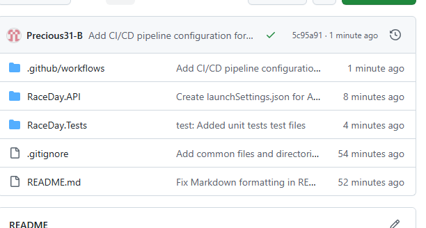

\# RaceDay API - Programming 2B POE Part 2

A RESTful API for the RaceDay Event Management System, built with ASP.NET Core Web API and Entity Framework Core.

\## System Overview

RaceDay is a full-stack web-based event management system for the South African road running, walking, and cycling community.

\## User Roles

| Role | Capabilities |

|------|--------------|

| \*\*Organiser\*\* | Create, update, delete events; manage categories; view enrolments; capture results |

| \*\*Participant\*\* | Browse events; enrol in events; view own enrolments and results |

\## Tech Stack

\- ASP.NET Core Web API (.NET 8)

\- SQL Server with Entity Framework Core

\- Session-based authentication with BCrypt

\- Swagger/OpenAPI

\- xUnit for testing

\- GitHub Actions CI/CD

\## Setup

1\. Clone the repository

2\. Open `RaceDay.API.sln` in Visual Studio 2022

3\. Run migrations: `Update-Database`

4\. Press F5 to run — Swagger opens

## CI/CD Status

### Successful Build

